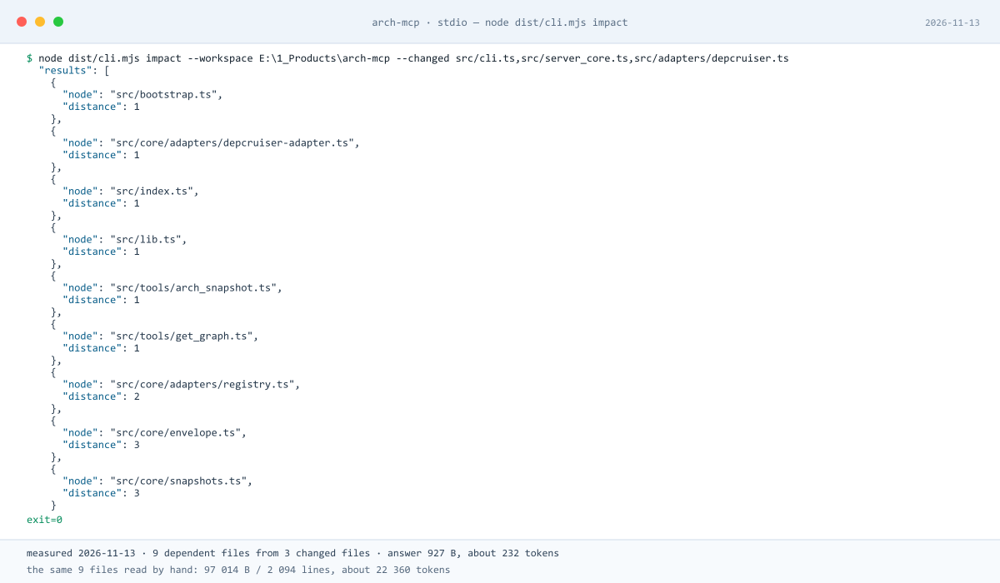

<picture>
  <source media="(prefers-color-scheme: dark)" srcset="assets/gitshow/banner-dark.svg">
  
</picture>

# arch-mcp

See the whole architecture of any codebase — and exactly what breaks before you change it

[English](README.md) | [Russian](README.ru.md)

[](LICENSE)
[](package.json)
[](package.json)



Measured on this repository on 2026-11-13: `impact` for three changed files answers in 927 bytes, about 232 tokens, and names nine dependent files. Reading those nine files by hand costs 97,014 bytes over 2,094 lines, about 22,360 tokens, so one answer costs roughly 1/96 of the context. The graph behind it holds 192 modules and 596 import edges.

`arch-mcp` is an MCP server over stdio. It indexes a workspace into a graph of files, modules, symbols, database tables, API contracts, container and CI files, then answers questions about that graph: what depends on this file, which tests a change touches, what two snapshots differ by.

## Features

**Find what a change breaks.** `impact` returns the transitive dependents of the files you changed, `affected_tests` narrows that to test files (`src/index.ts:93-121`).

**One graph across stacks.** 25 adapters read JavaScript/TypeScript, Python, nine more languages through wasm grammars, SQL, ORM schemas and calls (Prisma, JPA, SQLAlchemy, Drizzle), API contracts, manifests, Dockerfile, Kubernetes, CI YAML, Markdown and SCIP indexes (`src/core/adapters/registry.ts:71-102`). On this repository 20 of them report `ok` and five `absent`.

**Answers state their own coverage.** Every response carries `index.coverage` and `index.kinds`, so you can tell a missing edge from a missing adapter (`src/core/envelope.ts:59`, `src/core/envelope.ts:162-173`).

**Your repository stays untouched.** The server only reads: the cache lives in `%LOCALAPPDATA%\arch-mcp\cache\<sha1(repo)>` and nothing is written back (`src/cache.ts:8-11`).

**Responses respect a byte budget.** `max_bytes` defaults to 65536 with a hard cap of 1048576; a truncated answer always carries `truncated: true` and a `hint` (`src/config.ts:43-45`).

## What it sees

Every node is addressed as `kind:path#symbol` in repo-relative POSIX form (`src/core/adapters/types.ts:2`).

### Nodes (11)

| Kind | What it is |
| --- | --- |
| `file` | A source file or manifest on disk |
| `module` | An importable module, one per source file in the tree-sitter pipeline |
| `package` | A dependency: a manifest entry, a container image, or a CI action |
| `symbol` | A function, class or type declaration found by tree-sitter or SCIP |
| `table` | A SQL table |
| `view` | A SQL view |
| `api` | One API operation from an OpenAPI, Swagger, proto, GraphQL, AsyncAPI contract or a code route (Express, NestJS, Spring, FastAPI/Flask) |
| `config` | A configuration object: a CI file, a Kubernetes config referenced by `envFrom` |
| `doc` | A Markdown document |
| `service` | A deployable unit: an API service, a Kubernetes workload, a Terraform resource |
| `container` | A Dockerfile or the image it builds |

Source: `src/core/adapters/types.ts:5-16`.

### Edges (10)

| Edge | In plain words | Emitted today |
| --- | --- | --- |
| `imports` | File A uses file B | yes (`src/core/adapters/registry.ts:120-132`) |
| `calls` | Function A calls function B (a callee outside the file resolves to an imported or unique symbol) | yes (`src/core/adapters/registry.ts:133`; TS/JS, Python and all nine wasm languages) |
| `reads` | SQL or ORM: a table or view is read (Prisma/Drizzle in TS/JS, SQLAlchemy in Python, JPA `EntityManager` in Java); with sqlglot on, the SQL edge also carries columns | yes (`src/core/adapters/registry.ts:153`) |
| `writes` | SQL or ORM: a table is written by DML or an ORM call, with columns under sqlglot | yes (`src/core/adapters/registry.ts:154`) |
| `references` | An API operation, an infrastructure file, a document, or a package dependency points at an object | yes (`src/core/adapters/registry.ts:155-173`) |
| `deploys` | A Kubernetes workload deploys an image | yes (`src/core/adapters/registry.ts:175`) |
| `extends` | Class or interface inheritance | yes (`src/core/adapters/registry.ts:134-143`; 8 tree-sitter adapters: TS/JS, Python, Java, Kotlin, PHP, Ruby, C++, C#) |
| `implements` | Interface implementation | yes (`src/core/adapters/registry.ts:144-152`; TS/JS, Java, Kotlin, PHP, Rust and C# (the edge kind is decided by the target symbol) plus SCIP relationships) |
| `configures` | Configuration of another object | yes (`src/core/adapters/registry.ts:174`; Kubernetes `config` points back at the service that mounts it, Compose `environment` at the variables it names) |
| `tests` | A test covers a target | yes (`src/core/adapters/registry.ts:176-189`; a test file importing a target also gets a `tests` edge to it) |

`extends` and `implements` targets are resolved after the merge pass: same file first, then files the source imports, then a unique name across the graph; an ambiguous or unknown target drops the edge. The same resolution serves `calls`: a callee outside the file is emitted as `pending:<file>#<name>` and resolves to the imported or unique symbol, with `meta.derived_from="syntax"`. Call precision is conservative for member calls: `self`/`this` (`meta.call_scope="self"`) resolves only to a method of the current class; a call through an object (`meta.call_scope="member"`) resolves only when the object's type is locally known — a variable/field/parameter declared in the same file (type annotation, `new`, composite literal or constructor call) or a class-name receiver such as `Config.Map()`; the method is then looked up in that type (same file → imported files → a unique type name), otherwise the edge is dropped, so BCL/extension names (`services.BuildServiceProvider()`, `stack.Push()`, `typeof(x).MakeGenericType()`, `db.Users.Count()`, LINQ/extension helpers) no longer shadow a unique method name (`meta.member_type` carries the type). Python/Ruby/PHP member calls without `self`/`this` are dropped — the language gives no local type; a generic callee keeps the method name and ignores type arguments (`Config.Map<A, B>()` → `Map`); a `calls` edge whose target is declared in an interface carries `meta.target_kind="interface"`. `tests` edges are derived from `imports` edges whose source is a test file (rules: `*.test.*`, `*.spec.*`, `__tests__/`, `test_*.py`, `*_test.py`, `tests/`, `src/test/java/**/*Test.java`, `*Test.kt`, `*Tests.cs`, `*_test.go`, Rust files with `#[test]`/`#[cfg(test)]`, `*Test.php`, `*_spec.rb`, `spec/`), so one import yields two edges (`imports` and `tests`); `configures` is emitted next to the `references` edge of the same Kubernetes manifest.

## Coverage you can trust

The server never claims a complete picture it cannot back up.

- Each response carries `index.coverage` with `files_seen`, `parsed` and `unsupported`, plus `index.kinds` with the status of every edge kind (`src/core/envelope.ts:59`, `src/core/envelope.ts:171-173`). `coverage.files_seen` is the raw module count reported by the adapters; `graph.edge_count` counts `imports` edges only (R6b), while `graph.edges` and snapshots carry every kind with its own `type` (no `unknown` for `calls`/`tests`).
- An empty graph is reported as `index.state = "partial"`, not as an error (`src/core/envelope.ts:162-171`).
- Files a parser could not handle are listed by name in `coverage.unsupported`, and an adapter that failed turns the matching edge kind into `unsupported` instead of `no_matches` (`src/core/envelope.ts:130-154`).
- A kind with no emitters at all shows up as `not_emitted` (`src/core/envelope.ts:130-132`).

Supported layers: JavaScript/TypeScript, Python, nine languages through wasm tree-sitter grammars (C, C++, C#, Go, Java, Kotlin, PHP, Ruby, Rust), SQL (DML plus PostgreSQL DDL), API contracts (OpenAPI, Swagger, proto, GraphQL, AsyncAPI), Dockerfile, Kubernetes, CI YAML, Terraform behind a flag, Markdown, and SCIP indexes.

The invariants are covered by `tests/envelope.test.mjs` and `tests/kinds.test.mjs`; `tests/` holds 52 test files, and the suite ran 354 tests with 0 failures in 34.98 s on 2026-11-13 (`package.json:27`).

## Quick start

```powershell
npm install
npm run build
npm run bootstrap
npm test
```

`npm install` pulls runtime and dev dependencies. `npm run build` writes `dist/server.mjs`, `dist/cli.mjs` and `dist/lib.mjs` with esbuild. `npm run bootstrap` installs the pinned toolchain (dependency-cruiser 18.7.0) into `./toolchain` and is idempotent. `npm test` runs the node test suite (`package.json:24`, `package.json:26`, `package.json:27`).

## Connect your MCP client

The server speaks stdio through `dist/server.mjs`. An opencode v2 config entry looks like this:

```json
{
  "mcp": {
    "servers": {
      "arch-mcp": {
        "type": "local",
        "command": ["node", "<path-to>/arch-mcp/dist/server.mjs"]
      }
    }
  }
}
```

Replace the path with your own checkout. The MCP layer is thin: the tool contract sits in `src/index.ts:16-153` and calls run through `src/server_core.ts` (`src/index.ts:155-159`).

## Tools

| Tool | Arguments | Returns |
| --- | --- | --- |
| `arch_status` | `workspace?`, `max_bytes?` | Stacks, git info, index coverage, adapters |
| `arch_snapshot` | `workspace?`, `scope?`, `max_bytes?` | Graph plus `snapshot_id`; `scope` is `summary` or `full` |
| `search` | `workspace?`, `query`, `kind?`, `max_bytes?` | Graph nodes matching a case-insensitive substring |
| `focus` | `workspace?`, `node`, `limit?`, `max_bytes?`, `include_type_only?` | Incoming and outgoing edges of one node, `limit` defaults to 50, max 200 |
| `reaches` | `workspace?`, `target`, `max_depth?`, `max_bytes?`, `include_type_only?` | Reverse reachability: who depends on the target, `max_depth` defaults to 10 |
| `impact` | `workspace?`, `changed[]`, `depth?`, `max_bytes?`, `include_type_only?` | Transitive dependents of changed files |
| `affected_tests` | `workspace?`, `changed[]`, `max_bytes?`, `include_type_only?` | Test files depending on the change; an empty result carries a `reason` and the checked inputs |
| `arch_diff` | `workspace?`, `from`, `to`, `max_bytes?` | Added and removed nodes and edges between two refs |
| `arch_check` | `workspace?`, `rules?`, `max_bytes?` | Architecture rules: `cycles` (Tarjan SCC over imports), `layers` (per-layer `allow`), `forbidden` (glob → glob with reason); returns `{ok, violations[], checked{files, edges, rules_source}}`, violations sorted by rule then nodes/edges |

Source: `src/index.ts:16-153`.

## Response envelope

```json
{
  "ok": true,
  "workspace": "E:/work/my-service",
  "root_used": "E:/work/my-service",
  "roots": ["E:/work/my-service"],
  "schema_version": 7,
  "index": {
    "state": "ready",
    "progress": { "percent": 100, "complete": true },
    "coverage": { "files_seen": 226, "parsed": 226, "unsupported": [] },
    "adapters": [{ "name": "git", "status": "ok", "version": null }],
    "missing": []
  },
  "data": {},
  "truncated": false,
  "_meta": { "provenance": { "command": "arch_status", "cwd": "E:/work/my-service", "ts": "…", "cached": false, "exit_code": 0 } }
}
```

Failures come back as `{"ok": false, "error": {"code", "message", "hint", "candidates"}}` with one of the codes `WORKSPACE_NOT_FOUND`, `NODE_NOT_FOUND`, `AMBIGUOUS_NODE`, `INVALID_ARGUMENT`, `ADAPTER_UNAVAILABLE`, `INDEX_BUILDING`, `BUDGET_EXCEEDED`, `SNAPSHOT_NOT_FOUND`, `EXTERNAL_TOOL_FAILED` (`src/core/errors.ts:2-11`, `src/core/errors.ts:27`).

An empty graph gives `index.state = "partial"` (`src/core/envelope.ts:162-171`). An answer over the byte budget carries `truncated: true` and a hint that says to raise `max_bytes` (`src/tools/get_graph.ts:40-59`).

### index.kinds

`index.kinds` always holds ten entries in `EdgeKind` order. Each entry has `kind`, `status`, `edges`, `confidence`, `confidence_min` and `emitters` (`src/core/envelope.ts:30`, `src/core/envelope.ts:100-127`). `status` is one of:

- `emitted`: edges exist;
- `no_matches`: no edges, and every emitter for that kind ran;
- `unsupported`: no edges, and at least one emitter failed;
- `not_emitted`: the kind has no emitters in the registry at all (`src/core/envelope.ts:130-154`).

The invariant `sum(kinds.edges) == graph.edges.length` is checked by `tests/kinds.test.mjs`.

Only `index.state = "building"` breaks the rule of ten entries: a cold `arch_status` answers immediately with empty `kinds`, `adapters` and `missing`, zero coverage and `data.graph = null`, while the index builds in the background (`src/core/envelope.ts:182-197`, `src/tools/get_graph.ts:429-443`).

## Workspace discovery

`workspace` is optional. A `.git` directory anywhere above the working directory wins and is returned at once. Otherwise the server walks up to the nearest manifest (`package.json`, `pyproject.toml`, `requirements.txt`, `settings.gradle*`, `build.gradle*`) or to a directory with at least three source files. Markdown, JSON and YAML files do not make a root. No root means `WORKSPACE_NOT_FOUND` (`src/core/workspace.ts:7-12`, `src/core/workspace.ts:105-112`, `src/core/workspace.ts:152-163`).

A container without its own root resolves into child roots: the envelope reports `roots[]` and `root_used`. `ARCH_MCP_ALLOWED_ROOTS` turns discovery into an allowlist, and a path outside it answers `WORKSPACE_NOT_FOUND` (`src/core/workspace.ts:179-190`, `src/core/workspace.ts:228-244`).

## Adapters

All 25 adapters are built in and register at module load, so `index.adapters` reflects the registry at runtime (`src/core/adapters/registry.ts:71-102`). Run against this repository on 2026-11-13, `arch_status` reports 20 adapters `ok` and five `absent`. An adapter with no matching files reports `absent` and stays out of `index.adapters` and `missing[]` (`src/core/envelope.ts:115-117`). A broken grammar or ABI mismatch lands in `missing[]` with `state: partial` while the core keeps answering (`src/core/envelope.ts:150-173`).

| Adapter | Formats | Precision | What it adds |
| --- | --- | --- | --- |
| `scip` | SCIP `index.scip` | semantic | `symbol` nodes, `references` edges and `implements` edges from symbol relationships; a reference carrying the SCIP `Test` role becomes a `tests` edge. Every `references`/`tests` edge carries `meta.is_reference`, `meta.is_type_definition` (the target symbol is a class/interface/enum/struct/trait/type/type alias/union/protocol) and `meta.roles` (canonical order: `Import`, `WriteAccess`, `ReadAccess`, `Test`, `Generated`, `ForwardDefinition`). `scip-typescript` 0.6.2 marks an occurrence either as a symbol definition or as a plain reference: in a real index the only non-empty role is `Definition` (1933 of 6981 occurrences), `Test` is never set — so SCIP contributes `references` and `symbol` nodes, never `tests` edges, and `meta.roles` may be an empty array. SCIP never emits `calls`: an occurrence is a reference, not a call site. Path from `ARCH_MCP_SCIP_DIR` or `<root>/.arch/scip/index.scip` |
| `git` | git repository | manifest | HEAD and status metadata; no edges |
| `depcruiser` | JavaScript/TypeScript | syntax | import edges, type-only ones included; a test file also gets `tests` edges to what it imports |
| `api` | OpenAPI/Swagger, AsyncAPI, GraphQL SDL, `.proto` | syntax | `service` nodes for contracts and `references` edges; operation ids are built from the normalized path (`{name}`/`<name>` → `:name`, leading `/` added, trailing `/` dropped), so a contract and a code route for the same endpoint merge into one `api` node. Code routes themselves come from the language adapters (`tree-sitter-tsjs`, `tree-sitter-python`, `tree-sitter-java`) |
| `ci` | CI YAML | syntax | `config:<file>` nodes, `uses:` to `package:<action>` references |
| `compose` | Docker Compose (`docker-compose.yml`/`yaml`, `docker-compose.*.yml`/`yaml`, `compose.yml`/`yaml`) | syntax | `service:compose/<name>` nodes, `depends_on` as `references` service→service, `environment` as `config:<NAME>` nodes with `configures` service→config (names only, never values); `volumes`/`ports` stay in `meta` |
| `dockerfile` | Dockerfile | syntax | `container:<file>` and `package:<image>` nodes |
| `docs` | Markdown | syntax | `doc` nodes, headings in `meta.headings`, local links as `references` |
| `env` | `*.env.example`, `*.env.sample` | syntax | `config:<KEY>` nodes plus a `references` edge from the template file (names only — values are dropped; `.env`, `.env.local` and friends are never read) |
| `k8s` | Kubernetes YAML | syntax | `service:<Kind>/<name>`, `deploys` to an image, `envFrom`/`volumes` to `config` (`references` plus the reverse `configures`) |
| `manifests` | TOML/JSON manifests | manifest | `file` and `package` nodes with `references` to dependencies; monorepo membership (`package→package`) from `package.json` workspaces, `pnpm-workspace.yaml`, `go.work`, Cargo `[workspace] members` and Maven `<modules>`, and `package→file` from `package.json` `main` (`module` ignored) |
| `prisma` | `schema.prisma` | syntax | `table:<name>` nodes for models (`@@map("t")`, otherwise the model name), a `symbol` node per model and a `references` edge model to table only when `@@map` is present; relation fields are ignored |
| `sql` | SQL DML, PostgreSQL DDL | syntax | `table` and `view` nodes, `reads`, `writes`, `references` edges |
| `terraform` | Terraform HCL | syntax | `service:<type>.<name>` and `references` by interpolation; runs only with `ARCH_MCP_TERRAFORM=1` |
| `tree-sitter-c` | C | syntax | `module` and `imports` plus approximate `symbol` nodes; C has no inheritance, so no `extends` |
| `tree-sitter-cpp` | C++ | syntax | same plus `extends` from `base_class_clause` |
| `tree-sitter-csharp` | C# | syntax | same plus `calls` and `extends`/`implements` from `base_list`: the kind is decided by the target symbol (`meta.kind=interface` on `interface_declaration` → `implements`, otherwise `extends`) |
| `tree-sitter-go` | Go | syntax | same; Go has no inheritance, so no `extends`/`implements` |
| `tree-sitter-java` | Java | syntax | same plus `extends` (superclass, interface parents) and `implements`; Spring MVC routes as `api:<METHOD>:<path>` nodes with `references` edges to the handler method (`meta.framework="spring"`, `meta.derived_from="route"`), class `@RequestMapping` as the path prefix; JPA `@Entity` (+`@Table(name="...")`, otherwise the snake_case class name) gives `table:<name>` plus a `references` edge class to table, and `EntityManager.find` gives `reads`, `persist\|merge\|remove\|refresh` gives `writes` |
| `tree-sitter-kotlin` | Kotlin | syntax | same plus `extends` (constructor invocation) and `implements` (delegated types) |
| `tree-sitter-php` | PHP | syntax | same plus `extends` (class and interface bases) and `implements` |
| `tree-sitter-python` | Python | syntax | `module` nodes, `imports`, approximate `symbol` and `calls`, `extends` from `superclasses`; `calls` resolve across files; test files (`test_*.py`, `*_test.py`, `tests/`) also get `tests` edges; SQLAlchemy `__tablename__` gives `table:<name>` plus a `references` edge class to table, `session.query(Model)`/`select(Model)` gives `reads`, `.add()`/`.delete()` of a model instance gives `writes`; FastAPI/Flask routes (`@app\|@bp\|@router.get/post/route('...')`) as `api:<METHOD>:<path>` nodes with `references` edges to the handler (`meta.framework="fastapi"` or `"flask"`) |
| `tree-sitter-ruby` | Ruby | syntax | same as the generic languages plus `extends` from the `superclass` field |
| `tree-sitter-rust` | Rust | syntax | same plus `calls` and `implements` from `impl Trait for Struct` (type → trait); an `impl` without a trait emits nothing |
| `tree-sitter-tsjs` | JavaScript/TypeScript | syntax | `symbol` nodes, `calls` (cross-file callees via pending targets), `extends` and `implements` from `class_heritage`; `imports` belong to depcruiser; Express `app\|router.<verb>('...', handler)` and NestJS `@Controller('base')`+`@Get('path')` routes as `api:<METHOD>:<path>` nodes with `references` edges to the handler (`meta.framework="express"` or `"nestjs"`); ORM: Prisma `prisma.<model>.findMany\|findFirst\|findUnique\|findUniqueOrThrow` gives `reads`, `create\|createMany\|update\|updateMany\|upsert\|delete\|deleteMany` gives `writes` on `table:<model>`; Drizzle `db.select().from(<pgTable var>)` gives `reads`, `db.insert\|update\|delete(<pgTable var>)` gives `writes` |

Routes from code are extracted from AST literals only: Express `app|router.<verb>('<path>', handler)`, NestJS `@Controller('<base>')` plus `@Get('<path>')`, Spring `@RequestMapping('<base>')` plus `@GetMapping('<path>')`, FastAPI/Flask `@app|@bp|@router.get('<path>')`. Template/f-strings, path variables (`@app.get(path_var)`) and path arrays (`@GetMapping({"/vets"})`) are not supported and produce no node; a route whose handler symbol is not found still gets the `api` node but no edge.

Third-party licenses per dependency are listed in `THIRD_PARTY_NOTICES.md`; `grammars/LICENSE` holds the grammar provenance and `grammars/SHA256SUMS` the binary hashes.

### Type-only dependencies

Edges whose `dependencyTypes` contain `type-only` get `meta.type_only = true`. `focus`, `reaches`, `impact` and `affected_tests` exclude them unless you pass `include_type_only: true`. Collecting them needs depcruiser with `options.parser = tsc`, otherwise `import type` statements never reach the graph (`src/adapters/depcruiser.ts:77-83`).

The generated config is per repository and lives in the repository's own cache directory (`<cache>/<repo-sha1>/depcruise.config.json`); when the repository has a `tsconfig.json` (or `tsconfig.base.json`) at its root, the config carries `options.tsConfig.fileName` as an absolute path, so monorepo alias imports resolved through `tsconfig` `paths` keep their edges (`src/adapters/depcruiser.ts:86-160`). The tsconfig path also joins the cache key.

## Architecture rules (arch_check)

`arch_check` runs three rule groups over the imports edges of the graph. Rules live in `<workspace>/.arch/rules.json` (or a path passed in `rules`); without that file the default is `{"cycles":{"enabled":true}}` and `checked.rules_source` is `"default"`. An unreadable file or invalid JSON yields `INVALID_ARGUMENT` with a hint.

```json
{
  "layers": [
    { "name": "domain", "match": ["src/domain/**"], "allow": ["domain"] },
    { "name": "ui", "match": ["src/ui/**"], "allow": ["ui"] }
  ],
  "forbidden": [
    { "from": "src/ui/**", "to": "src/db/**", "reason": "ui must not import db directly" }
  ],
  "cycles": { "enabled": true }
}
```

- `cycles` — strongly connected components (Tarjan) over `imports` edges; a component with more than one node, or a self-loop, becomes one violation.
- `layers` — for every `imports` edge, the target layer must be listed in the source layer's `allow`; else a violation. A node matches the first layer whose `match` globs hit its repo-relative path.
- `forbidden` — any `imports` edge whose source matches `from` and target matches `to` (globs: `**`, `*`, `?`), with `reason` in the message.
- `undetermined` — an unresolved bare import (depcruiser `dependencyTypes` contains `undetermined`) keeps its `imports` edge but is not checked in `cycles`/`layers`/`forbidden`: its `resolved` points at the file itself and a `circular` flag on it is an artifact, not a cycle (`meta.undetermined`, wave F).

Result: `{ok, violations:[{rule, kind, message, nodes[], edges[], files[]}], checked:{files, edges, rules_source}}`; violations are sorted by `rule`, then `nodes`/`edges`, so repeated runs are identical (`src/tools/arch_check.ts`).

## Snapshots and arch_diff

`arch_snapshot` computes `snapshot_id = SHA256(graph JSON + git HEAD + adapter versions)` and stores the snapshot in the cache. `arch_diff` compares two refs: `current`, git HEAD (a hex string of 7 to 39 characters, an ambiguous prefix yields `AMBIGUOUS_NODE` with candidates), or a `snapshot_id`. A missing snapshot yields `SNAPSHOT_NOT_FOUND`, a malformed ref yields `INVALID_ARGUMENT`; arbitrary git revisions such as `HEAD~1` are v1.1 (`src/core/snapshots.ts:11-12`, `src/core/snapshots.ts:136-139`, `src/core/snapshots.ts:171-175`).

## CLI

```text
node dist/cli.mjs <status|snapshot|search|focus|reaches|impact|affected-tests|diff|check> [--workspace <path>] [--json]
node dist/cli.mjs check [--workspace <path>] [--rules <path>] [--json]
node dist/cli.mjs bootstrap
```

Options include `--json`, `--scope`, `--query`, `--kind`, `--node`, `--target`, `--changed`, `--limit`, `--max-depth`, `--depth`, `--max-bytes`, `--include-type-only`, `--from`, `--to` and `--rules`. Exit codes: 0 on success, 1 on a contract error, 2 on a usage error (`src/cli.ts:8-26`, `src/cli.ts:155-187`). For `check` the codes are 0 (clean), 1 (violations found, output still carries the envelope) and 2 (rules or input error) (`src/cli.ts`, `check` branch). Without `ARCH_MCP_MAX_RESPONSE_BYTES` the budget is 65536, and `status` prints the line `budget: 65536` (`src/cli.ts:135`).

Sample call arguments:

```json
{ "name": "impact", "arguments": { "workspace": "E:\\work\\my-service", "changed": ["server/src/limits.ts"], "depth": 3 } }
{ "name": "affected_tests", "arguments": { "workspace": "E:\\work\\my-service", "changed": ["server/src/limits.ts"] } }
{ "name": "arch_check", "arguments": { "workspace": "E:\\work\\my-service" } }
```

## Configuration

| Variable | Default | Meaning |
| --- | --- | --- |
| `ARCH_MCP_STACKS` | `all` | Stack filter: `py`, `jvm`, `js`, `csharp` or `all` (`csharp` = recursive `*.csproj`/`*.sln` search, depth ≤3) |
| `ARCH_MCP_TIMEOUT_MS` | `120000` | Timeout for every external process |
| `ARCH_MCP_MAX_RESPONSE_BYTES` | `65536` | Response budget, cap `1048576`, above it `BUDGET_EXCEEDED` |
| `ARCH_MCP_ALLOWED_ROOTS` | not set | Workspace allowlist separated by `path.delimiter`; unset means no restriction |
| `ARCH_MCP_CACHE_DIR` | `%LOCALAPPDATA%\arch-mcp\cache` | Cache root override for graphs and snapshots |
| `ARCH_MCP_ALLOW_EXEC` | off | `1` enables optional external tools |
| `ARCH_MCP_AUTO_INSTALL` | off | Installs the toolchain automatically when missing |
| `ARCH_MCP_GRAMMAR_DIR` | `<package>/grammars` | wasm grammar directory override |
| `ARCH_MCP_SCIP_DIR` | not set | Directory or `index.scip` file for the `scip` adapter (example: `E:\work\arch-mcp\toolchain\scip\out\class-validator` after indexing a corpus repo with `@sourcegraph/scip-typescript`; on Windows PowerShell: `$env:ARCH_MCP_SCIP_DIR="<dir>"`, on bash: `ARCH_MCP_SCIP_DIR=<dir> arch-mcp status --workspace <repo>`) |
| `ARCH_MCP_SCIP_INDEXER` | not set | Indexer command template with `{root}` and `{out}` tokens; needs `ARCH_MCP_ALLOW_EXEC=1` |
| `ARCH_MCP_TERRAFORM` | off | `1` enables the lazy MPL-2.0 `@cdktf/hcl2json` import |
| `ARCH_MCP_SQLGLOT` | off | `1` adds the sqlglot bridge for CTAS, materialized views, ALTER-FK and column lineage |
| `ARCH_MCP_PYTHON` | `python` | Interpreter for the sqlglot bridge |
| `ARCH_MCP_SQLGLOT_BRIDGE` | `<package>/python/sqlglot_bridge.py` | Bridge path override; the file content joins the cache key |
| `ARCH_MCP_IGNORE` | not set | Extra directory names to skip, at any depth, comma separated (example: `.next,dist,my-artifacts`). Added to the built-in base in `src/core/ignore.ts`; the resulting set joins the cache key |

Most variables are read in `src/config.ts:42-70`; the root allowlist is read in `src/core/workspace.ts:179`.

### Ignored directories

One list, `src/core/ignore.ts`, is shared by the file walkers, the depcruiser run and the non-git cache signature: `node_modules`, `.git`, `dist`, `build`, `coverage`, `.next`, `out`, `target`, `.turbo`, `toolchain`, `vendor`, `venv`, `.venv`, `.tox`, `__pycache__`, `.mypy_cache`, `.pytest_cache`, `.ruff_cache`. Names are matched at any depth and case-insensitively on Windows, so `BUILD/`, `DIST/` and `Out/` are skipped as well.

`ARCH_MCP_IGNORE` extends that base and never shrinks it. The same set is compiled into the single `--exclude` regex of dependency-cruiser (one argument: the CLI option has no `collect`, so repeated flags keep only the last one — `bin/dependency-cruiser.mjs:69`), and `node_modules` is always part of it (without it depcruiser runs out of memory on repositories that vendor dependencies).

## What v1 does not do

- **Run your code.** No tests, builds or scripts from the repository; external processes go through one runner, and the trusted core uses git read-only and depcruise (`src/core/exec.ts:5-12`).
- **Generate a SCIP index by default.** The adapter reads a ready index; an external indexer runs only with `ARCH_MCP_SCIP_INDEXER` and `ARCH_MCP_ALLOW_EXEC=1` (`src/config.ts:67-70`).
- **Write into the repository.** Tools only read the workspace; the cache and snapshots stay outside it (`src/cache.ts:8-11`).
- **Diff arbitrary git revisions.** `arch_diff` covers `current`, `HEAD` and `snapshot_id` (`src/core/snapshots.ts:171-175`).
- **Drive the Terraform CLI.** The adapter parses HCL through `@cdktf/hcl2json`; no `plan`, `validate` or `apply` call is made (`src/adapters/infra/terraform.ts:2-3`, `src/adapters/infra/terraform.ts:78`).
- **Exact inheritance resolution.** `extends`/`implements` targets are matched heuristically: same file, then files the source imports, then a unique name across the graph; an ambiguous target drops the edge and no compiler-grade type resolution is attempted (`src/core/adapters/resolve.ts:1-14`).
- **Inheritance for Go and C.** There is none: neither language has inheritance. C# is decided heuristically by the target symbol (an interface declaration carries `meta.kind=interface`); Rust reads `impl Trait for Struct`. SCIP contributes `implements` only: the index schema has no `extends` relationship.
- **Merging Compose overrides.** `docker-compose.override.yml` and other Compose variants are parsed as independent files: services are not merged with the base file, so an override adds its own `service:compose/<name>` entries (`src/adapters/infra/compose.ts:1-14`).
- **Annotation path arrays.** Host-mount path lists of the form `a:/b,c:/d` are not split into separate entries (planned for a later wave); a Compose file that points a service at `.env` values only contributes variable *names*, never values.

ORM edges come only from explicit evidence: a Prisma model / `pgTable()` / `__tablename__` / `@Entity` declaration or a JPA `EntityManager` field type. Dynamic table names (`env()` in `@@map`, computed strings), a receiver of unknown type and a model declared in another file produce no `reads`/`writes` edge.

## Notes and limits

- **Cache key.** Git HEAD, mtimes of changed files, toolchain version, config hashes (including the ignore signature `ignore`), the depcruiser parser mode and the repo-relative `tsconfig` path, the adapter signature, `GRAPH_SCHEMA_VERSION` and the package version (`src/cache.ts:104-152`, `src/tools/get_graph.ts:137-160`). A non-git workspace is keyed by a sha256 signature over the concatenated `path\tsha256(content)` lines of every file outside the ignore base, so replacing a file with same-length content and restoring its mtime still invalidates the cache (`src/cache.ts:200-247`). Changing `ARCH_MCP_IGNORE` changes the key, so a git-cache entry built with another ignore set is not reused.
- **Build artifacts stay out.** `.next/`, `dist/`, `build/`, `out/`, `coverage/` and the rest of the ignore base are skipped by the walkers, the depcruiser run and the cache signature alike, so their content neither enters the graph nor invalidates the cache (`src/core/ignore.ts:1-30`).
- **Server version.** `initialize` reports `serverInfo.version` from `package.json` (`packageVersion()`, `src/cache.ts:49-66`) — `0.3.1` for this release (`src/index.ts:11-13`).
- **Schema versions.** `SCHEMA_VERSION = 7` moves with the response shape, `GRAPH_SCHEMA_VERSION = "graph-17"` only with the graph or cache entry content/shape (`src/core/envelope.ts:15-19`, `src/cache.ts:60`). 0.3.1 changed edge content (unresolved bare imports carry `meta.undetermined` instead of a false `circular`), so the `arch_check` result form is unchanged but cached graphs are rebuilt.
- **Test files and the graph.** A test file that imports a target gets two edges to it: `imports` and `tests`. `focus` on the target shows both, so a target covered by one test reports `counts.incoming = 2`. Both kinds run in a cold build after the adapter deltas merge; `extends`/`implements` targets are resolved before the cache entry and `index.kinds` counters are computed (`src/tools/get_graph.ts:504`, `src/core/adapters/resolve.ts:52-60`).
- **Single flight.** Identical concurrent calls share one run (`src/tools/get_graph.ts:308-423`); a cache hit marks the evidence command with a `(cached)` suffix and sets `provenance.cached` (`src/tools/get_graph.ts:361`, `src/provenance.ts:31`).
- **Non-blocking build.** The tree-sitter pipeline yields to the event loop every eight files, so a cold `arch_status` answers within seconds and the graph builds in the background (`src/core/adapters/tree-sitter/generic.ts:165`, `src/tools/get_graph.ts:442-443`).

## License

MIT (`LICENSE:1-3`). Third-party components and their licenses are listed in `THIRD_PARTY_NOTICES.md`.
