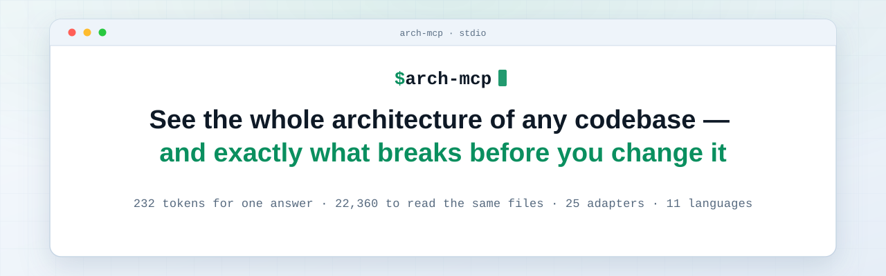
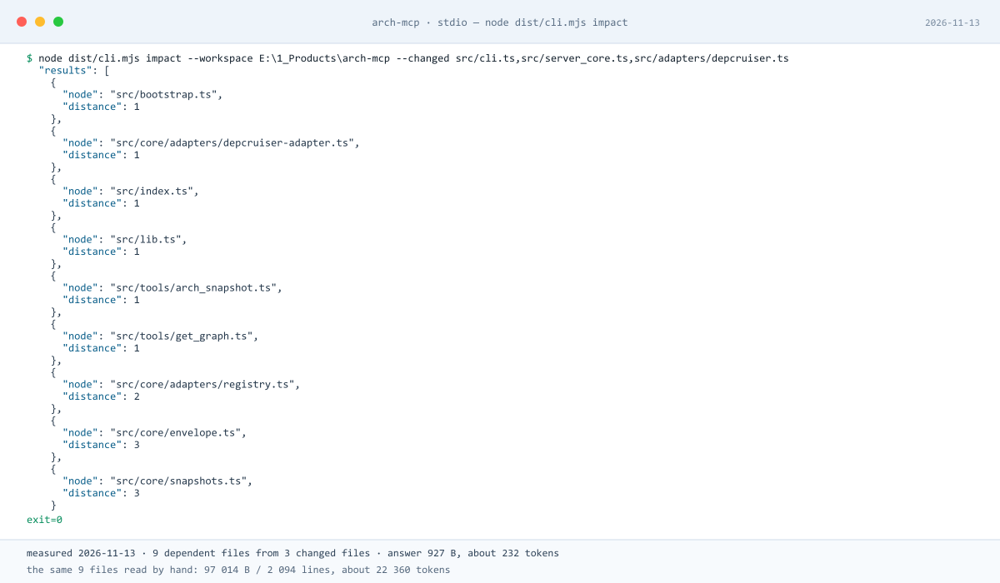

<picture>
  <source media="(prefers-color-scheme: dark)" srcset="assets/gitshow/banner-dark.svg">
  
</picture>

# arch-mcp

Увидеть всю архитектуру любой кодовой базы — и что именно сломается, прежде чем вы что-то измените

[English](README.md) | [Русский](README.ru.md)

[](LICENSE)
[](package.json)
[](package.json)



Замер на этом репозитории 13.11.2026: `impact` по трём изменённым файлам отвечает в 927 байтах, это около 232 токенов, и называет девять зависимых файлов. Чтение этих девяти файлов руками стоит 97 014 байт на 2 094 строках, около 22 360 токенов, то есть один ответ занимает примерно 1/96 контекста. Граф, из которого собран ответ, держит 192 модуля и 596 рёбер импортов.

`arch-mcp` — MCP-сервер поверх stdio. Он собирает workspace в граф из файлов, модулей, символов, таблиц базы, API-контрактов, контейнерных и CI-файлов, а затем отвечает на вопросы по этому графу: что зависит от файла, какие тесты заденет правка, чем отличаются два снимка.

## Возможности

**Показывает, что сломает правка.** `impact` возвращает транзитивных зависимых изменённых файлов, `affected_tests` сужает список до тестовых файлов (`src/index.ts:93-121`).

**Один граф на все стеки.** 25 адаптеров читают JavaScript/TypeScript, Python, ещё девять языков через wasm-грамматики, SQL, ORM-схемы и вызовы (Prisma, JPA, SQLAlchemy, Drizzle), API-контракты, манифесты, Dockerfile, Kubernetes, CI YAML, Markdown и SCIP-индексы (`src/core/adapters/registry.ts:71-102`). На этом репозитории 20 из них отдают `ok`, пять — `absent`.

**Ответ сам сообщает о своём покрытии.** Каждый конверт несёт `index.coverage` и `index.kinds`, поэтому пропущенное ребро не спутать с незапущенным адаптером (`src/core/envelope.ts:59`, `src/core/envelope.ts:162-173`).

**Репозиторий остаётся нетронутым.** Сервер только читает: кэш лежит в `%LOCALAPPDATA%\arch-mcp\cache\<sha1(repo)>`, обратной записи нет (`src/cache.ts:8-11`).

**Ответ укладывается в заданный бюджет.** `max_bytes` по умолчанию 65536, жёсткий потолок 1048576; обрезанный ответ всегда несёт `truncated: true` и `hint` (`src/config.ts:43-45`).

## Что он видит

Каждый узел адресуется как `kind:path#symbol` в repo-relative POSIX-форме (`src/core/adapters/types.ts:2`).

### Узлы (11)

| Вид | Что это |
| --- | --- |
| `file` | Исходный файл или манифест на диске |
| `module` | Импортируемый модуль, по одному на исходный файл в конвейере tree-sitter |
| `package` | Зависимость: запись манифеста, образ контейнера или CI-экшен |
| `symbol` | Объявление функции, класса или типа, найденное tree-sitter или SCIP |
| `table` | Таблица SQL |
| `view` | Представление SQL |
| `api` | Одна API-операция из контракта OpenAPI, Swagger, proto, GraphQL, AsyncAPI или маршрута из кода (Express, NestJS, Spring, FastAPI/Flask) |
| `config` | Объект конфигурации: CI-файл, конфиг Kubernetes, на который ссылается `envFrom` |
| `doc` | Документ Markdown |
| `service` | Разворачиваемая единица: API-сервис, нагрузка Kubernetes, ресурс Terraform |
| `container` | Dockerfile или собранный им образ |

Источник: `src/core/adapters/types.ts:5-16`.

### Связи (10)

| Связь | Человеческими словами | Эмитится сейчас |
| --- | --- | --- |
| `imports` | Файл A использует файл B | да (`src/core/adapters/registry.ts:120-132`) |
| `calls` | Функция A вызывает функцию B (callee вне файла резолвится в импортированный или уникальный символ) | да (`src/core/adapters/registry.ts:133`; TS/JS, Python и все девять wasm-языков) |
| `reads` | SQL или ORM: таблица или представление читается (Prisma/Drizzle в TS/JS, SQLAlchemy в Python, JPA `EntityManager` в Java); при включённом sqlglot SQL-ребро несёт ещё и колонки | да (`src/core/adapters/registry.ts:153`) |
| `writes` | SQL или ORM: таблица пишется через DML или ORM-вызов, с колонками при sqlglot | да (`src/core/adapters/registry.ts:154`) |
| `references` | API-операция, инфраструктурный файл, документ или зависимость пакета ссылается на объект | да (`src/core/adapters/registry.ts:155-173`) |
| `deploys` | Нагрузка Kubernetes разворачивает образ | да (`src/core/adapters/registry.ts:175`) |
| `extends` | Наследование класса или интерфейса | да (`src/core/adapters/registry.ts:134-143`; 8 tree-sitter адаптеров: TS/JS, Python, Java, Kotlin, PHP, Ruby, C++, C#) |
| `implements` | Реализация интерфейса | да (`src/core/adapters/registry.ts:144-152`; TS/JS, Java, Kotlin, PHP, Rust и C# (вид ребра решает целевой символ) и relationships SCIP) |
| `configures` | Настройка другого объекта | да (`src/core/adapters/registry.ts:174`; Kubernetes `config` указывает обратно на сервис, который его монтирует, Compose `environment` — на переменные, которые называет) |
| `tests` | Тест покрывает цель | да (`src/core/adapters/registry.ts:176-189`; тестовый файл, импортирующий цель, получает к ней ещё и ребро `tests`) |

Цели `extends`/`implements` резолвятся после слияния: сначала тот же файл, затем файлы, которые источник импортирует, затем уникальное имя во всём графе; неоднозначная или неизвестная цель отбрасывает ребро. Так же резолвятся `calls`: callee вне файла эмитится как `pending:<file>#<name>` и резолвится в импортированный или уникальный символ, `meta.derived_from="syntax"`. Точность `calls` для member-вызовов консервативная: `self`/`this` (`meta.call_scope="self"`) резолвится только в метод текущего класса; вызов через объект (`meta.call_scope="member"`) резолвится только при локально известном типе объекта — переменная/поле/параметр, объявленные в том же файле (аннотация типа, `new`, composite literal или вызов конструктора), либо получатель-имя класса (`Config.Map()`); метод ищется в этом типе (тот же файл → импортированные файлы → уникальное имя типа), иначе ребро отбрасывается — поэтому имена BCL/extension-методов (`services.BuildServiceProvider()`, `stack.Push()`, `typeof(x).MakeGenericType()`, `db.Users.Count()`, LINQ/extension-хелперы) больше не шэдоуят уникальное имя метода (`meta.member_type` несёт тип). Member-вызовы Python/Ruby/PHP без `self`/`this` отбрасываются — локального типа язык не даёт; у дженерика callee — имя метода без аргументов типа (`Config.Map<A, B>()` → `Map`); ребро `calls` на метод, объявленный в интерфейсе, несёт `meta.target_kind="interface"`. Каждый конверт несёт `coverage.files_seen` (сырое число модулей от адаптеров) и `graph.edge_count` (только `imports`-рёбра, R6b); `graph.edges` и снимки несут все виды с их `type` (для `calls`/`tests` — без `unknown`). Рёбра `tests` производны от `imports`: если источник — тестовый файл (правила: `*.test.*`, `*.spec.*`, `__tests__/`, `test_*.py`, `*_test.py`, `tests/`, `src/test/java/**/*Test.java`, `*Test.kt`, `*Tests.cs`, `*_test.go`, Rust-файл с `#[test]`/`#[cfg(test)]`, `*Test.php`, `*_spec.rb`, `spec/`), один импорт даёт два ребра (`imports` и `tests`). `configures` эмитится рядом с ребром `references` того же Kubernetes-манифеста.

## Покрытие, которому можно верить

Сервер не заявляет полноту картины, которую не может подтвердить.

- Каждый конверт несёт `index.coverage` с `files_seen`, `parsed` и `unsupported`, а также `index.kinds` со статусом каждого вида связей (`src/core/envelope.ts:59`, `src/core/envelope.ts:171-173`).
- Пустой граф отдаётся как `index.state = "partial"`, а не как ошибка (`src/core/envelope.ts:162-171`).
- Файлы, которые парсер не осилил, перечисляются по именам в `coverage.unsupported`, а упавший адаптер переводит свой вид связей в `unsupported` вместо `no_matches` (`src/core/envelope.ts:130-154`).
- Вид без эмиттеров вовсе показывается как `not_emitted` (`src/core/envelope.ts:130-132`).

Поддержанные слои: JavaScript/TypeScript, Python, девять языков через wasm-грамматики tree-sitter (C, C++, C#, Go, Java, Kotlin, PHP, Ruby, Rust), SQL (DML и PostgreSQL DDL), API-контракты (OpenAPI, Swagger, proto, GraphQL, AsyncAPI), Dockerfile, Kubernetes, CI YAML, Terraform под флагом, Markdown и SCIP-индексы.

Инварианты покрыты тестами `tests/envelope.test.mjs` и `tests/kinds.test.mjs`; в `tests/` 52 тестовых файла, а прогон 13.11.2026 дал 354 теста без падений за 34,98 с (`package.json:27`).

## Быстрый старт

```powershell
npm install
npm run build
npm run bootstrap
npm test
```

`npm install` ставит runtime- и dev-зависимости. `npm run build` пишет `dist/server.mjs`, `dist/cli.mjs` и `dist/lib.mjs` через esbuild. `npm run bootstrap` ставит закреплённый toolchain (dependency-cruiser 18.7.0) в `./toolchain` и идемпотентен. `npm test` прогоняет набор тестов node (`package.json:24`, `package.json:26`, `package.json:27`).

## Подключение MCP-клиента

Сервер говорит по stdio через `dist/server.mjs`. Запись в конфиге opencode v2 выглядит так:

```json
{
  "mcp": {
    "servers": {
      "arch-mcp": {
        "type": "local",
        "command": ["node", "<path-to>/arch-mcp/dist/server.mjs"]
      }
    }
  }
}
```

Путь замените на свой. Слой MCP тонкий: контракт инструментов лежит в `src/index.ts:16-153`, вызовы идут через `src/server_core.ts` (`src/index.ts:155-159`).

## Инструменты

| Инструмент | Аргументы | Что отдаёт |
| --- | --- | --- |
| `arch_status` | `workspace?`, `max_bytes?` | Стеки, данные git, покрытие индекса, адаптеры |
| `arch_snapshot` | `workspace?`, `scope?`, `max_bytes?` | Граф и `snapshot_id`; `scope` — `summary` или `full` |
| `search` | `workspace?`, `query`, `kind?`, `max_bytes?` | Узлы графа по подстроке без учёта регистра |
| `focus` | `workspace?`, `node`, `limit?`, `max_bytes?`, `include_type_only?` | Входящие и исходящие рёбра одного узла; `limit` по умолчанию 50, максимум 200 |
| `reaches` | `workspace?`, `target`, `max_depth?`, `max_bytes?`, `include_type_only?` | Обратная достижимость: кто зависит от цели; `max_depth` по умолчанию 10 |
| `impact` | `workspace?`, `changed[]`, `depth?`, `max_bytes?`, `include_type_only?` | Транзитивные зависимые изменённых файлов |
| `affected_tests` | `workspace?`, `changed[]`, `max_bytes?`, `include_type_only?` | Тестовые файлы, зависящие от правки; пустой результат несёт `reason` и проверенные входы |
| `arch_diff` | `workspace?`, `from`, `to`, `max_bytes?` | Добавленные и удалённые узлы и рёбра между двумя ref |
| `arch_check` | `workspace?`, `rules?`, `max_bytes?` | Проверки архитектуры: `cycles` (Tarjan SCC по рёбрам imports), `layers` (список `allow` у слоя), `forbidden` (glob → glob с `reason`); результат `{ok, violations[], checked{files, edges, rules_source}}`, violations отсортированы по rule, затем nodes/edges |

Источник: `src/index.ts:16-153`.

## Конверт ответа

```json
{
  "ok": true,
  "workspace": "E:/work/my-service",
  "root_used": "E:/work/my-service",
  "roots": ["E:/work/my-service"],
  "schema_version": 7,
  "index": {
    "state": "ready",
    "progress": { "percent": 100, "complete": true },
    "coverage": { "files_seen": 226, "parsed": 226, "unsupported": [] },
    "adapters": [{ "name": "git", "status": "ok", "version": null }],
    "missing": []
  },
  "data": {},
  "truncated": false,
  "_meta": { "provenance": { "command": "arch_status", "cwd": "E:/work/my-service", "ts": "…", "cached": false, "exit_code": 0 } }
}
```

Ошибки приходят как `{"ok": false, "error": {"code", "message", "hint", "candidates"}}` с одним из кодов `WORKSPACE_NOT_FOUND`, `NODE_NOT_FOUND`, `AMBIGUOUS_NODE`, `INVALID_ARGUMENT`, `ADAPTER_UNAVAILABLE`, `INDEX_BUILDING`, `BUDGET_EXCEEDED`, `SNAPSHOT_NOT_FOUND`, `EXTERNAL_TOOL_FAILED` (`src/core/errors.ts:2-11`, `src/core/errors.ts:27`).

Пустой граф даёт `index.state = "partial"` (`src/core/envelope.ts:162-171`). Ответ сверх бюджета несёт `truncated: true` и подсказку поднять `max_bytes` (`src/tools/get_graph.ts:40-59`).

### index.kinds

`index.kinds` всегда содержит десять записей в порядке `EdgeKind`. У записи есть `kind`, `status`, `edges`, `confidence`, `confidence_min` и `emitters` (`src/core/envelope.ts:30`, `src/core/envelope.ts:100-127`). `status` принимает значения:

- `emitted`: рёбра есть;
- `no_matches`: рёбер нет, и все эмиттеры вида отработали;
- `unsupported`: рёбер нет, и хотя бы один эмиттер упал;
- `not_emitted`: у вида в реестре нет эмиттеров вовсе (`src/core/envelope.ts:130-154`).

Инвариант `sum(kinds.edges) == graph.edges.length` проверяет `tests/kinds.test.mjs`.

Правило десяти записей нарушает только `index.state = "building"`: холодный `arch_status` отвечает сразу с пустыми `kinds`, `adapters` и `missing`, нулевым покрытием и `data.graph = null`, а индекс строится в фоне (`src/core/envelope.ts:182-197`, `src/tools/get_graph.ts:429-443`).

## Поиск workspace

`workspace` необязателен. Каталог `.git` на любом уровне выше рабочего каталога выигрывает и возвращается сразу. Иначе сервер идёт вверх до ближайшего манифеста (`package.json`, `pyproject.toml`, `requirements.txt`, `settings.gradle*`, `build.gradle*`) либо до каталога минимум с тремя исходными файлами. Файлы Markdown, JSON и YAML корнем не делают. Нет корня — `WORKSPACE_NOT_FOUND` (`src/core/workspace.ts:7-12`, `src/core/workspace.ts:105-112`, `src/core/workspace.ts:152-163`).

Контейнер без собственного корня разворачивается в дочерние корни: конверт несёт `roots[]` и `root_used`. `ARCH_MCP_ALLOWED_ROOTS` превращает поиск в allowlist, а путь вне списка отвечает `WORKSPACE_NOT_FOUND` (`src/core/workspace.ts:179-190`, `src/core/workspace.ts:228-244`).

## Адаптеры

Все 25 адаптеров встроены и регистрируются при загрузке модуля, поэтому `index.adapters` отражает реестр во время работы (`src/core/adapters/registry.ts:71-102`). На этом репозитории прогон `arch_status` 13.11.2026 отдаёт 20 адаптеров `ok` и пять `absent`. Адаптер без подходящих файлов отдаёт `absent` и не попадает в `index.adapters` и `missing[]` (`src/core/envelope.ts:115-117`). Битая грамматика или несовпадение ABI уходят в `missing[]` со `state: partial`, а ядро продолжает отвечать (`src/core/envelope.ts:150-173`).

| Адаптер | Форматы | Precision | Что даёт |
| --- | --- | --- | --- |
| `scip` | SCIP `index.scip` | semantic | Узлы `symbol`, рёбра `references` и `implements` из relationships символов; ссылка с ролью SCIP `Test` даёт ребро `tests`. У каждого ребра `references`/`tests` есть `meta.is_reference`, `meta.is_type_definition` (цель — класс/интерфейс/enum/структура/trait/тип/алиас типа/объединение/протокол) и `meta.roles` (канонический порядок: `Import`, `WriteAccess`, `ReadAccess`, `Test`, `Generated`, `ForwardDefinition`). `scip-typescript` 0.6.2 помечает occurrence либо как объявление символа, либо как обычную ссылку: в реальном индексе единственная непустая роль — `Definition` (1933 из 6981 occurrence), `Test` не выставляется никогда — поэтому вклад scip — рёбра `references` и узлы `symbol`, рёбер `tests` от него нет, а `meta.roles` может быть пустым массивом. SCIP никогда не даёт `calls`: occurrence — это ссылка, а не место вызова. Путь из `ARCH_MCP_SCIP_DIR` либо `<root>/.arch/scip/index.scip` |
| `git` | git-репозиторий | manifest | Метаданные HEAD и status; рёбер не даёт |
| `depcruiser` | JavaScript/TypeScript | syntax | Рёбра импортов, включая type-only; тестовый файл получает ещё и рёбра `tests` к тому, что импортирует |
| `api` | OpenAPI/Swagger, AsyncAPI, GraphQL SDL, `.proto` | syntax | Узлы `service` для контрактов и рёбра `references`; id операции строится из нормализованного пути (`{name}`/`<name>` → `:name`, ведущий `/` добавляется, хвостовой убирается), поэтому контракт и маршрут кода для одного эндпоинта сливаются в один узел `api`. Маршруты кода дают языковые адаптеры (`tree-sitter-tsjs`, `tree-sitter-python`, `tree-sitter-java`) |
| `ci` | CI YAML | syntax | Узлы `config:<file>`, рёбра `uses:` к `package:<action>` |
| `compose` | Docker Compose (`docker-compose.yml`/`yaml`, `docker-compose.*.yml`/`yaml`, `compose.yml`/`yaml`) | syntax | Узлы `service:compose/<name>`, `depends_on` как `references` service→service, `environment` как узлы `config:<NAME>` с `configures` service→config (только имена, никогда значения); `volumes`/`ports` остаются в `meta` |
| `dockerfile` | Dockerfile | syntax | Узлы `container:<file>` и `package:<image>` |
| `docs` | Markdown | syntax | Узлы `doc`, заголовки в `meta.headings`, локальные ссылки как `references` |
| `env` | `*.env.example`, `*.env.sample` | syntax | Узлы `config:<KEY>` и ребро `references` от файла-шаблона (только имена — значения отбрасываются; `.env`, `.env.local` и подобные не читаются) |
| `k8s` | Kubernetes YAML | syntax | `service:<Kind>/<name>`, `deploys` к образу, `envFrom`/`volumes` к `config` (`references` плюс обратное `configures`) |
| `manifests` | Манифесты TOML/JSON | manifest | Узлы `file` и `package` со ссылками на зависимости; членство монорепо (`package→package`) из `package.json` workspaces, `pnpm-workspace.yaml`, `go.work`, Cargo `[workspace] members` и Maven `<modules>`, и `package→file` по полю `main` у `package.json` (`module` игнорируется) |
| `prisma` | `schema.prisma` | syntax | Узлы `table:<имя>` на модель (`@@map("t")`, иначе имя модели), `symbol`-узел модели и ребро `references` модель → таблица только при `@@map`; поля-связи игнорируются |
| `sql` | SQL DML, PostgreSQL DDL | syntax | Узлы `table` и `view`, рёбра `reads`, `writes`, `references` |
| `terraform` | Terraform HCL | syntax | `service:<type>.<name>` и `references` по интерполяции; работает только с `ARCH_MCP_TERRAFORM=1` |
| `tree-sitter-c` | C | syntax | `module` и `imports` плюс приблизительные узлы `symbol`; наследования в C нет, `extends` не эмитится |
| `tree-sitter-cpp` | C++ | syntax | то же плюс `extends` из `base_class_clause` |
| `tree-sitter-csharp` | C# | syntax | то же плюс `calls` и `extends`/`implements` из `base_list`: вид ребра решает целевой символ (`meta.kind=interface` у `interface_declaration` → `implements`, иначе `extends`) |
| `tree-sitter-go` | Go | syntax | то же; наследования в Go нет, `extends`/`implements` не эмитятся |
| `tree-sitter-java` | Java | syntax | то же плюс `extends` (superclass, родители интерфейса) и `implements`; маршруты Spring MVC как узлы `api:<METHOD>:<path>` с рёбрами `references` на метод-обработчик (`meta.framework="spring"`, `meta.derived_from="route"`), классовый `@RequestMapping` как префикс пути; JPA `@Entity` (+`@Table(name="...")`, иначе snake_case имени класса) даёт `table:<имя>` и ребро `references` класс → таблица, `EntityManager.find` даёт `reads`, `persist\|merge\|remove\|refresh` даёт `writes` |
| `tree-sitter-kotlin` | Kotlin | syntax | то же плюс `extends` (constructor_invocation) и `implements` (делегированные типы) |
| `tree-sitter-php` | PHP | syntax | то же плюс `extends` (базы класса и интерфейса) и `implements` |
| `tree-sitter-python` | Python | syntax | Узлы `module`, `imports`, приблизительные `symbol` и `calls`, `extends` из `superclasses`; `calls` резолвятся между файлами; тестовые файлы (`test_*.py`, `*_test.py`, `tests/`) получают ещё и `tests`; маршруты FastAPI/Flask (`@app\|@bp\|@router.get/post/route('...')`) как узлы `api:<METHOD>:<path>` с рёбрами `references` на обработчик (`meta.framework="fastapi"` или `"flask"`); SQLAlchemy `__tablename__` даёт `table:<имя>` и ребро `references` класс → таблица, `session.query(Model)`/`select(Model)` дают `reads`, `.add()`/`.delete()` экземпляра модели дают `writes` |
| `tree-sitter-ruby` | Ruby | syntax | то же, что у универсальных языков, плюс `extends` из поля `superclass` |
| `tree-sitter-rust` | Rust | syntax | то же плюс `calls` и `implements` из `impl Trait for Struct` (type → trait); `impl` без trait рёбер не даёт |
| `tree-sitter-tsjs` | JavaScript/TypeScript | syntax | Узлы `symbol`, `calls` (межфайловые callee через pending-цели), `extends` и `implements` из `class_heritage`; `imports` принадлежат depcruiser; маршруты Express `app\|router.<verb>('...', handler)` и NestJS `@Controller('base')`+`@Get('path')` как узлы `api:<METHOD>:<path>` с рёбрами `references` на обработчик (`meta.framework="express"` или `"nestjs"`); ORM: Prisma `prisma.<model>.findMany\|findFirst\|findUnique\|findUniqueOrThrow` даёт `reads`, `create\|createMany\|update\|updateMany\|upsert\|delete\|deleteMany` даёт `writes` на `table:<model>`; Drizzle `db.select().from(<переменная pgTable>)` даёт `reads`, `db.insert\|update\|delete(<переменная pgTable>)` даёт `writes` |

Маршруты из кода извлекаются только из литералов AST: Express `app|router.<verb>('<path>', handler)`, NestJS `@Controller('<base>')` плюс `@Get('<path>')`, Spring `@RequestMapping('<base>')` плюс `@GetMapping('<path>')`, FastAPI/Flask `@app|@bp|@router.get('<path>')`. Шаблонные и f-строки, переменные пути (`@app.get(path_var)`) и массивы путей (`@GetMapping({"/vets"})`) не поддерживаются и узла не дают; если symbol-обработчик не найден, узел `api` создаётся, ребро не эмитится.

Лицензии сторонних компонентов перечислены в `THIRD_PARTY_NOTICES.md`; провенанс грамматик — в `grammars/LICENSE`, хэши бинарей — в `grammars/SHA256SUMS`.

### Type-only зависимости

Рёбра, у которых `dependencyTypes` содержит `type-only`, получают `meta.type_only = true`. `focus`, `reaches`, `impact` и `affected_tests` не учитывают их без `include_type_only: true`. Для сбора нужен depcruiser с `options.parser = tsc`, иначе `import type` в граф не попадает вовсе (`src/adapters/depcruiser.ts:77-83`).

Конфиг генерируется на каждый репозиторий и лежит в его кэш-каталоге (`<кэш>/<sha1 репозитория>/depcruise.config.json`); если в корне есть `tsconfig.json` (иначе `tsconfig.base.json`), в конфиг пишется `options.tsConfig.fileName` абсолютным путём — alias-импорты монорепо через `paths` сохраняют рёбра (`src/adapters/depcruiser.ts:86-160`). Путь tsconfig входит и в ключ кэша.

## Правила архитектуры (arch_check)

`arch_check` проверяет три группы правил по рёбрам imports готового графа. Правила лежат в `<workspace>/.arch/rules.json` (либо по пути из `rules`); нет файла — дефолт `{"cycles":{"enabled":true}}` и `checked.rules_source = "default"`. Нечитаемый файл или невалидный JSON — `INVALID_ARGUMENT` с подсказкой.

```json
{
  "layers": [
    { "name": "domain", "match": ["src/domain/**"], "allow": ["domain"] },
    { "name": "ui", "match": ["src/ui/**"], "allow": ["ui"] }
  ],
  "forbidden": [
    { "from": "src/ui/**", "to": "src/db/**", "reason": "ui не импортирует db напрямую" }
  ],
  "cycles": { "enabled": true }
}
```

- `cycles` — компоненты сильной связности (Tarjan) по рёбрам `imports`; компонента больше одного узла либо самопетля даёт одну violation.
- `layers` — для каждого ребра imports слой-цель обязан быть в `allow` слоя-источника, иначе violation. Узел относится к первому слою, чей glob `match` попал в его repo-relative путь.
- `forbidden` — ребро imports, у которого источник попадает в `from`, а цель в `to` (glob: `**`, `*`, `?`), даёт violation с `reason` в сообщении.
- `undetermined` — неразрешённый bare-импорт (у depcruiser `dependencyTypes` содержит `undetermined`) сохраняет ребро `imports`, но в `cycles`/`layers`/`forbidden` не участвует: его `resolved` указывает на сам файл, а флаг `circular` на нём — артефакт, не цикл (`meta.undetermined`, волна F).

Результат: `{ok, violations:[{rule, kind, message, nodes[], edges[], files[]}], checked:{files, edges, rules_source}}`; порядок violations детерминирован (rule, затем nodes/edges), повторный прогон даёт тот же ответ (`src/tools/arch_check.ts`).

## Снимки и arch_diff

`arch_snapshot` считает `snapshot_id = SHA256(JSON графа + git HEAD + версии адаптеров)` и хранит снимок в кэше. `arch_diff` сравнивает два ref: `current`, git HEAD (hex-строка длиной 7–39 символов; неоднозначный префикс даёт `AMBIGUOUS_NODE` с кандидатами) либо `snapshot_id`. Нет снимка — `SNAPSHOT_NOT_FOUND`, битый ref — `INVALID_ARGUMENT`; произвольные git-ревизии вроде `HEAD~1` отложены до v1.1 (`src/core/snapshots.ts:11-12`, `src/core/snapshots.ts:136-139`, `src/core/snapshots.ts:171-175`).

## CLI

```text
node dist/cli.mjs <status|snapshot|search|focus|reaches|impact|affected-tests|diff|check> [--workspace <path>] [--json]
node dist/cli.mjs check [--workspace <path>] [--rules <path>] [--json]
node dist/cli.mjs bootstrap
```

Опции: `--json`, `--scope`, `--query`, `--kind`, `--node`, `--target`, `--changed`, `--limit`, `--max-depth`, `--depth`, `--max-bytes`, `--include-type-only`, `--from`, `--to`, `--rules`. Коды выхода: 0 при успехе, 1 при ошибке контракта, 2 при ошибке использования (`src/cli.ts:8-26`, `src/cli.ts:155-187`). У команды `check` коды свои: 0 — чисто, 1 — есть violations (конверт при этом печатается), 2 — ошибка правил или входа (`src/cli.ts`, ветка `check`). Без `ARCH_MCP_MAX_RESPONSE_BYTES` бюджет 65536, и `status` печатает строку `budget: 65536` (`src/cli.ts:135`).

## Настройка

| Переменная | По умолчанию | Смысл |
| --- | --- | --- |
| `ARCH_MCP_STACKS` | `all` | Фильтр стеков: `py`, `jvm`, `js`, `csharp` или `all` (`csharp` — рекурсивный поиск `*.csproj`/`*.sln`, глубина ≤3) |
| `ARCH_MCP_TIMEOUT_MS` | `120000` | Таймаут любого внешнего процесса |
| `ARCH_MCP_MAX_RESPONSE_BYTES` | `65536` | Бюджет ответа, потолок `1048576`, выше — `BUDGET_EXCEEDED` |
| `ARCH_MCP_ALLOWED_ROOTS` | не задана | Allowlist workspace через `path.delimiter`; не задана — ограничений нет |
| `ARCH_MCP_CACHE_DIR` | `%LOCALAPPDATA%\arch-mcp\cache` | Override корня кэша графов и снимков |
| `ARCH_MCP_ALLOW_EXEC` | выкл | `1` разрешает опциональные внешние инструменты |
| `ARCH_MCP_AUTO_INSTALL` | выкл | Ставит toolchain автоматически, если его нет |
| `ARCH_MCP_GRAMMAR_DIR` | `<пакет>/grammars` | Override каталога wasm-грамматик |
| `ARCH_MCP_SCIP_DIR` | не задана | Каталог или файл `index.scip` для адаптера `scip` (пример: `E:\work\arch-mcp\toolchain\scip\out\class-validator` после индексации корпусного репозитория через `@sourcegraph/scip-typescript`; PowerShell: `$env:ARCH_MCP_SCIP_DIR="<каталог>"`, bash: `ARCH_MCP_SCIP_DIR=<каталог> arch-mcp status --workspace <репо>`) |
| `ARCH_MCP_SCIP_INDEXER` | не задана | Шаблон команды индексера с токенами `{root}` и `{out}`; нужен `ARCH_MCP_ALLOW_EXEC=1` |
| `ARCH_MCP_TERRAFORM` | выкл | `1` включает ленивый импорт `@cdktf/hcl2json` (MPL-2.0) |
| `ARCH_MCP_SQLGLOT` | выкл | `1` добавляет мост sqlglot: CTAS, materialized views, ALTER-FK и lineage колонок |
| `ARCH_MCP_PYTHON` | `python` | Интерпретатор для моста sqlglot |
| `ARCH_MCP_SQLGLOT_BRIDGE` | `<пакет>/python/sqlglot_bridge.py` | Override пути моста; содержимое файла входит в ключ кэша |
| `ARCH_MCP_IGNORE` | не задано | Дополнительные имена каталогов (на любой глубине), через запятую (пример: `.next,dist,my-artifacts`). Дополняют базу `src/core/ignore.ts`; итоговый набор входит в ключ кэша |

Большинство переменных читает `src/config.ts:42-70`; allowlist корней — `src/core/workspace.ts:179`.

### Исключаемые каталоги

Список один — `src/core/ignore.ts`; его читают обходчики файлов, запуск depcruiser и подпись не-git кэша: `node_modules`, `.git`, `dist`, `build`, `coverage`, `.next`, `out`, `target`, `.turbo`, `toolchain`, `vendor`, `venv`, `.venv`, `.tox`, `__pycache__`, `.mypy_cache`, `.pytest_cache`, `.ruff_cache`. Имена сравниваются на любой глубине и без учёта регистра на Windows, поэтому `BUILD/`, `DIST/` и `Out/` тоже пропускаются.

`ARCH_MCP_IGNORE` дополняет базу и никогда её не сужает. Тот же набор склеивается в один `--exclude` dependency-cruiser: у CLI-опции нет `collect`, поэтому повторные флаги сохраняют только последний (`bin/dependency-cruiser.mjs:69`), а `node_modules` в наборе обязателен — без него depcruiser падает по памяти на репозиториях с вендоренными зависимостями.

## Чего нет в v1

- **Запуска вашего кода.** Ни тестов, ни сборок, ни скриптов репозитория: внешние процессы идут через один запускатель, доверенное ядро — это git read-only и depcruise (`src/core/exec.ts:5-12`).
- **Генерации SCIP-индекса по умолчанию.** Адаптер читает готовый индекс; внешний индексер запускается только с `ARCH_MCP_SCIP_INDEXER` и `ARCH_MCP_ALLOW_EXEC=1` (`src/config.ts:67-70`).
- **Записи в репозиторий.** Инструменты только читают workspace, кэш и снимки лежат вне его (`src/cache.ts:8-11`).
- **Диффа произвольных git-ревизий.** `arch_diff` покрывает `current`, `HEAD` и `snapshot_id` (`src/core/snapshots.ts:171-175`).
- **Управления Terraform CLI.** Адаптер разбирает HCL через `@cdktf/hcl2json`; вызовов `plan`, `validate` и `apply` нет (`src/adapters/infra/terraform.ts:2-3`, `src/adapters/infra/terraform.ts:78`).
- **Точного резолва наследования.** Цели `extends`/`implements` сопоставляются эвристикой: тот же файл, затем файлы, которые источник импортирует, затем уникальное имя во всём графе; неоднозначная цель отбрасывает ребро, типовая система компилятора не привлекается (`src/core/adapters/resolve.ts:1-14`).
- **Наследования для Go и C.** Его нет: ни в Go, ни в C наследования нет. В C# вид ребра решает целевой символ (`meta.kind=interface` у `interface_declaration` даёт `implements`, иначе `extends`), в Rust `impl Trait for Struct` даёт `implements` (`src/core/adapters/tree-sitter/languages.ts:115`, `src/core/adapters/tree-sitter/languages.ts:222-232`). SCIP даёт только `implements`: relationship `extends` в схеме индекса отсутствует.
- **Слияния Compose-override.** `docker-compose.override.yml` и другие варианты Compose разбираются как независимые файлы: сервисы не сливаются с базовым файлом, override добавляет свои `service:compose/<name>` (`src/adapters/infra/compose.ts:1-14`).
- **Массивов путей в аннотациях.** Списки вида `a:/b,c:/d` не разделяются на отдельные записи (план следующей волны); Compose-файл даёт только имена переменных, значения не читаются вовсе.

Рёбра ORM строятся только по явному свидетельству: объявление модели Prisma / `pgTable()` / `__tablename__` / `@Entity` либо тип поля `EntityManager`. Динамические имена таблиц (`env()` в `@@map`, вычисляемые строки), получатель неизвестного типа и модель, объявленная в другом файле, рёбер `reads`/`writes` не дают.

## Заметки и ограничения

- **Ключ кэша.** Git HEAD, mtime изменённых файлов, версия toolchain, хэши конфигов (включая подпись игнора `ignore`), режим парсера depcruiser и repo-relative путь `tsconfig`, подпись адаптеров, `GRAPH_SCHEMA_VERSION` и версия пакета (`src/cache.ts:104-152`, `src/tools/get_graph.ts:137-160`). Для не-git workspace ключ — sha256 по строкам `путь\tsha256(содержимого)` всех файлов вне базы игнора, поэтому подмена файла контентом той же длины с возвратом mtime кэш всё равно инвалидирует (`src/cache.ts:200-247`). Смена `ARCH_MCP_IGNORE` меняет ключ: запись git-кэша с другим набором исключений не переиспользуется.
- **Артефакты сборки вне графа.** `.next/`, `dist/`, `build/`, `out/`, `coverage/` и остальная база игнора пропускаются и обходчиками, и depcruiser, и подписью кэша: их содержимое не попадает ни в граф, ни в инвалидацию (`src/core/ignore.ts:1-30`).
- **Версия сервера.** `initialize` отдаёт `serverInfo.version` из `package.json` (`packageVersion()`, `src/cache.ts:49-66`) — `0.3.1` в этом релизе (`src/index.ts:11-13`).
- **Версии схемы.** `SCHEMA_VERSION = 7` меняется вместе с формой ответа, `GRAPH_SCHEMA_VERSION = "graph-17"` — только с содержимым/формой графа или записи кэша (`src/core/envelope.ts:15-19`, `src/cache.ts:60`). В 0.3.1 изменилось содержимое рёбер (неразрешённые bare-импорты несут `meta.undetermined` вместо ложного `circular`), поэтому форма ответа `arch_check` та же, но граф из кэша пересобирается.
- **Тестовые файлы в графе.** Тестовый файл, импортирующий цель, получает к ней два ребра: `imports` и `tests`. `focus` по цели показывает оба, поэтому цель, покрытая одним тестом, даёт `counts.incoming = 2`. Цели `extends`/`implements` резолвятся после слияния дельт, до записи кэша и подсчёта `index.kinds` (`src/tools/get_graph.ts:504`, `src/core/adapters/resolve.ts:52-60`).
- **Single-flight.** Одинаковые одновременные вызовы делят один прогон (`src/tools/get_graph.ts:308-423`); попадание в кэш помечает команду в evidence суффиксом `(cached)` и ставит `provenance.cached` (`src/tools/get_graph.ts:361`, `src/provenance.ts:31`).
- **Неблокирующая сборка.** Конвейер tree-sitter уступает событийному циклу каждые восемь файлов, поэтому холодный `arch_status` отвечает за секунды, а граф строится в фоне (`src/core/adapters/tree-sitter/generic.ts:165`, `src/tools/get_graph.ts:442-443`).

## Лицензия

MIT (`LICENSE:1-3`). Сторонние компоненты и их лицензии перечислены в `THIRD_PARTY_NOTICES.md`.
